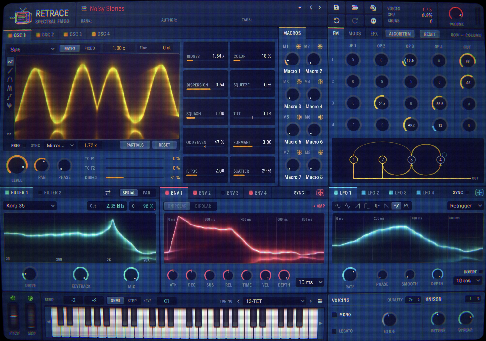

<p align="center">
  
</p>

<h1 align="center">Retrace</h1>

<p align="center">
  <a href="https://github.com/kunitoki/retrace/actions/workflows/build_macos.yml"></a>
  <a href="https://github.com/kunitoki/retrace/actions/workflows/build_windows.yml"></a>
  <a href="https://github.com/kunitoki/retrace/actions/workflows/build_linux.yml"></a>
  <a href="https://github.com/kunitoki/retrace/actions/workflows/build_ios.yml"></a>
  <a href="https://github.com/kunitoki/retrace/actions/workflows/build_android.yml"></a>
  <a href="https://github.com/kunitoki/retrace/actions/workflows/build_wasm.yml"></a>
  <a href="https://github.com/kunitoki/retrace/actions/workflows/coverage.yml"></a>
</p>

<p align="center">
  
</p>

Retrace is a four operator **spectral frequency modulated synthesiser**, built with the
[YUP](https://github.com/kunitoki/yup) framework.

> Formats: **CLAP · VST3 · AU · AUv3 · LV2 · AAX · Standalone**.

---

## What it does

- **Four operators**, each a spectral oscillator whose partials can be drawn, frequency modulating
  one another. The network runs oversampled at 1x, 2x or 4x, and stacks up to seven copies of
  itself for unison.
- **Two filters, four drawn envelopes and four LFOs**, 64 modulation routes and eight macros.
- **Eight voices**, polyphonic, mono or legato.
- **A reorderable chain of eleven master effects**: distortion, waveshaper, bitcrusher, EQ,
  compressor, chorus, phaser, flanger, delay, plate reverb and a mid/side widener.
- **Tunings**: built-in temperaments and equal divisions, or a Scala (`.scl`, `.kbm`) or AnaMark
  (`.tun`) file, saved with the patch.
- **A preset browser** with fuzzy search, categories, tags, ratings and favorites, over more than
  90 factory presets, user preset files and read-only preset banks.
- **Every control is a host parameter**, automatable and modulatable.
- **An MCP server**, off by default, that lets AI assistants design sounds, play the synth and
  listen to it.

## Prerequisites

- **CMake** ≥ 3.31
- A C++20 toolchain:
  - macOS: Xcode (with command line tools)
  - Windows: Visual Studio 2022/2026
  - Linux: GCC/Clang + the audio/X11/GL dev packages (see `.github/workflows/build_linux.yml`)
- [`just`](https://github.com/casey/just) *(optional, for the convenience recipes below)*

YUP is a git submodule, so clone recursively:

```bash
git clone --recursive https://github.com/kunitoki/retrace.git
cd retrace
```

Already cloned without `--recursive`? Pull the submodule in:

```bash
git submodule update --init --recursive
```

## Building

Every platform is generated into its own `build/<platform>` folder (`mac`, `win`, `linux`, `ninja`,
`ios`, `ios_sim`, `android`, `emscripten`), so several platforms can live side by side.

Using `just` (recommended):

```bash
just mac                  # generate + open an Xcode project in build/mac (macOS)
just win                  # generate + open a Visual Studio solution in build/win (Windows)
just linux                # generate a Ninja build in build/linux (Linux)
just ninja                # generate a Ninja build in build/ninja (any host)
just build                # build every enabled plugin format and the standalone (Release)
just build ninja Debug    # pick the build/<platform> folder and the configuration
just clean mac            # wipe build/mac (or `just clean` to wipe everything)
```

`PLATFORM` defaults to the host's native folder: `mac` on macOS, `win` on Windows and `linux` on
Linux. Pass extra CMake arguments to the generate recipes with `cmake_args`:

```bash
just cmake_args="-DPLUGIN_COPY_AFTER_BUILD=OFF" ninja
```

Using CMake directly:

```bash
cmake -G "Ninja Multi-Config" -B build/ninja
cmake --build build/ninja --config Release --target retrace
```

| Target | Builds |
|--------|--------|
| `retrace` | Every enabled plugin format and the standalone application |
| `retrace_<format>_plugin` | One format: `clap`, `vst3`, `au`, `auv3`, `lv2`, `aax`, `standalone` |
| `retrace_tests` | The test suite |
| `retrace_benchmarks` | The audio benchmarks |

Each format is built in a folder of its own under `build/<platform>` (`CLAP`, `VST3`, `AU`, `AUv3`,
`LV2`, `AAX`), and the standalone application under `build/<platform>/<Config>/`.

> [!NOTE]
> On macOS every build installs the plugins into your user plugin folders
> (`~/Library/Audio/Plug-Ins`), so a host picks them up right away. Configure with
> `-DPLUGIN_COPY_AFTER_BUILD=OFF` to leave them in the build folder.

**AAX** needs the Avid SDK. It is enabled when `YUP_AAX_SDK_ROOT` is set (environment or CMake
cache), or when the SDK sits at `../AAX/aax-sdk-2-9-0` beside this repository.

## Testing

```bash
just test                 # build + run the test suite via CTest (Debug)
just test ninja Release   # ...from a specific build folder and configuration
just bench                # build + run the audio benchmarks (Release)
```

Or directly:

```bash
cmake --build build/ninja --config Debug --target retrace_tests
ctest --test-dir build/ninja/tests -C Debug --output-on-failure
```

The tests and the benchmarks link the same plugin core every format is built from, so they exercise
the code that ships. They are built on desktop only. The tests read the Retrace settings of the
user running them and write the plugin log, see [User data](#user-data).

## Presets

The factory presets are the `.retrace` files under `data/presets`, one folder per category. At
configure time CMake packs them into a `Factory.rebank` zip archive and embeds it in the plugin, so
editing, adding or removing a file there is picked up by the next build. Only the Init patch is
defined in code.

A `.rebank` file is a plain zip archive of `.retrace` presets, in any folder layout, renamed. Put
one in the user preset folder or in a folder added to the browser and its presets are listed in
place, read-only, under the bank's name. To make one: `cd MyBank && zip -r ../MyBank.rebank .`

`tools/` holds the Python scripts the factory bank was generated with, through the MCP server
below: `retrace_mcp.py` is a small MCP client with a patch builder and an audition renderer,
`generate_presets.py` and `profile_presets.py` use it. The two scripts read the preset definitions
from a `presets.py` module that is not part of this repository.

## Controlling Retrace from an AI assistant (MCP)

Retrace embeds an [MCP](https://github.com/kunitoki/yup/blob/main/docs/ai/mcp.md) server, so
assistants such as Claude or Copilot can design sounds, play the synth and listen to it.

1. Open the settings menu in the header and enable **MCP Server**. The setting is saved and off by
   default. It does nothing in the browser build.
2. Pick **Copy http://127.0.0.1:7380/mcp** from the same menu. Every open instance takes the next
   free port from 7380.
3. Add the server to the MCP client configuration:

```json
{
  "mcpServers": {
    "retrace": { "type": "http", "url": "http://127.0.0.1:7380/mcp" }
  }
}
```

The server only listens on `127.0.0.1` and rejects requests from web pages.

| Group | Tools |
|-------|-------|
| Synth | `get_synth_info` |
| Parameters | `list_parameters`, `get_parameters`, `set_parameters` (plain or normalized values) |
| Patch | `get_patch`, `set_patch` (merge or replace), `describe_patch_format`, `randomize_patch` |
| Presets | `list_presets`, `load_preset` (also a `.retrace` file or a preset inside a `.rebank` by path), `set_preset_info`, `save_preset` |
| Playing | `note_on`, `note_off`, `all_notes_off`, `send_midi`, `play_notes` |
| Audio | `render_audio` (offline, with parameter automation), `start_capture`, `stop_capture` |
| Editor | `screenshot` |

A patch is the whole sound: every parameter plus partials, curves, modulation routes, the effect
chain, tuning and preset info. `describe_patch_format` explains it, so an assistant can write
patches from scratch. Audio comes back as a WAV file, inline audio content or both, with an analysis
(levels, crest factor, spectral centroid, octave bands, tail). The patch, parameters, format and
preset list are also readable as `retrace://` resources.

## User data

Retrace keeps its files under the vendor and product names (`COMPANY_NAME` and `PRODUCT_NAME` in
`CMakeLists.txt`). On macOS:

| What | Where |
|------|-------|
| Settings, favorites and ratings | `~/Library/Preferences/YUP Audio/Retrace/settings.xml` |
| User presets and banks | `~/Library/Audio/Presets/YUP Audio/Retrace` |
| Log, one per plugin format | `~/Library/Logs/Retrace_<format>.log` |

## Packaging

The `packaging/` directory contains scripts that collect the built artifacts into native
installers. Build the project first, then:

```bash
just icons          # (re)generate app-icon.icns / app-icon.ico from assets/app-icon.png
just package-macos  # macOS .pkg from build/mac
just package-linux  # Linux .tar.gz + .deb from build/linux
just package-win    # Windows installer from build/win
just package-wasm   # WebAssembly .tar.gz from build/emscripten
```

| Platform | Output | Requires |
|----------|--------|----------|
| macOS   | `.pkg` installer (plugins + standalone) | Xcode command line tools |
| Linux   | `.tar.gz` archive **and** `.deb` package | `dpkg-deb` |
| Windows | `.exe` installer                         | [Inno Setup 6](https://jrsoftware.org/isinfo.php) |
| iOS     | Unsigned `.ipa`                          | Xcode |
| Android | `.apk`                                   | Android SDK / NDK |
| WebAssembly | `.tar.gz` of the standalone          | Emscripten |

Installers are written to `dist/`. See [`packaging/README.md`](packaging/README.md) for details,
signing options and layout.

## Configuration

The product is described by the variables near the top of `CMakeLists.txt`. The `justfile`, the CI
workflows and the packaging scripts all read these values from there, so they must stay plain
literal strings: the scripts can't expand `${...}` references.

| Variable | Description |
|----------|-------------|
| `PROJECT_NAME` | Internal name and target prefix (no spaces, different from `PRODUCT_NAME`) |
| `PRODUCT_NAME` / `PRODUCT_DESCRIPTION` | Name and description of the plugin, its standalone and the installers |
| `COMPANY_NAME` | Vendor name, also the folder the user data lives in |
| `BUNDLE_ID` | Reverse-domain identifier: the plugin id and the prefix of every bundle id |
| `PRODUCT_URL` / `PRODUCT_EMAIL` | Website and contact metadata |
| `PLUGIN_CODE` / `PLUGIN_MANUFACTURER_CODE` | Four-character AU/AAX codes |
| `PLUGIN_AAX_NATIVE_CODE` / `PLUGIN_AAX_AUDIOSUITE_CODE` / `PLUGIN_AAX_CATEGORY` | AAX plugin ids and category |
| `INSTALLER_GUID` | Windows installer AppId |

> [!WARNING]
> `PRODUCT_NAME`, `COMPANY_NAME`, `BUNDLE_ID`, the four-character codes and `INSTALLER_GUID`
> identify Retrace to hosts, to saved sessions and to installed copies. Changing one after a release
> orphans existing sessions, presets and settings.

The version lives in the `VERSION` file (`MAJOR.MINOR.PATCH`) and can be overridden with
`-DTARGET_VERSION=...`.

Toggle formats and features with CMake options, e.g. `-DPLUGIN_BUILD_VST3=OFF`:

`PLUGIN_BUILD_CLAP`, `PLUGIN_BUILD_VST3`, `PLUGIN_BUILD_AU`, `PLUGIN_BUILD_AUV3`, `PLUGIN_BUILD_LV2`,
`PLUGIN_BUILD_STANDALONE`, `PLUGIN_COPY_AFTER_BUILD`, `BUILD_TESTS`, `BUILD_BENCHMARKS`,
`ENABLE_COVERAGE`, `ENABLE_CODE_SIGNING`.

## Project layout

```
.
├── CMakeLists.txt          # Product configuration and the plugin target
├── VERSION                 # Single source of truth for the version
├── cmake/utilities.cmake   # Shared CMake helper macros
├── assets/                 # Product icon (png/ico/icns) and screenshot
├── data/
│   ├── presets/            # Factory presets, one folder per category
│   └── shaders/            # Shaders of the interface
├── source/
│   ├── RetraceProcessor.*  # The audio processor
│   ├── RetraceEditor.*     # The editor
│   ├── dsp/                # Sound engine, parameters and patch format
│   ├── ui/                 # Interface
│   ├── browser/            # Preset library and browser model
│   └── mcp/                # MCP server and its audio tools
├── tests/                  # GoogleTest suite
├── benchmarks/             # google/benchmark audio benchmarks
├── tools/                  # Python scripts for the factory bank
├── packaging/              # Installer scripts for every platform
├── .github/workflows/      # Per-platform CI
└── yup/                    # YUP framework (git submodule)
```

## License

Retrace is distributed under the terms of the [LICENSE](LICENSE) file. YUP has its own license; see
the [YUP repository](https://github.com/kunitoki/yup).
